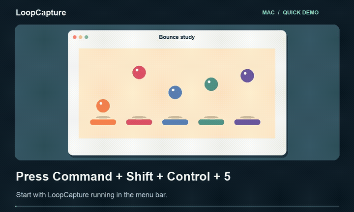

# LoopCapture

Use LoopCapture like the Mac screenshot tool for video: drag around what you want to show, then press Space when you're done.
Record a short clip with system audio and paste it into a chat to send to a friend.
If a silent loop gets the point across, turn the same clip into a GIF right in the preview.

**[Download LoopCapture for Mac](https://github.com/rahul-nath/LoopCapture/releases/latest/download/LoopCapture-macOS-arm64.pkg)** · Apple Silicon (M-series) · macOS 15 or later

## Watch the 20-second demo

[](docs/media/loopcapture-demo.mp4)

[Open the full-resolution MP4](docs/media/loopcapture-demo.mp4).

## Install and start

1. Double-click the downloaded **LoopCapture-macOS-arm64.pkg** and follow the Installer prompts.
2. Open **Applications → LoopCapture**. Look for the recording icon in the menu bar.
3. On your first recording, macOS asks for **Screen & System Audio Recording** access. Enable LoopCapture in **System Settings → Privacy & Security**, choose **Quit & Reopen** if prompted, then press the shortcut again.

The installer includes the compiled app and uses the media frameworks built into macOS.
The official installer is signed with Rahul Nath’s Developer ID and includes Apple’s notarization ticket.

### If macOS keeps asking for recording access

Quit LoopCapture and open the installed copy in **Applications**.
If you previously ran an unsigned or ad-hoc build, macOS may need one fresh approval for the signed release.
If LoopCapture is already enabled but still denied, quit it, remove its old entry in **Privacy & Security → Screen & System Audio Recording**, then use **+** to add **/Applications/LoopCapture.app**, enable it, and reopen it.
Subsequent official releases keep the same signing identity.

### Uninstall or test a fresh permission grant

Choose **Quit LoopCapture** from its menu bar icon, then move **LoopCapture** from **Applications** to the Trash.
Your saved MP4s and GIFs stay in their recording folder.

For a fresh-permission test, quit the app and run `tccutil reset ScreenCapture local.rahul.LoopCapture` in Terminal before moving it to the Trash.
Reinstall the official package, open **Applications → LoopCapture**, and approve the first recording request.
Quit and reopen the app, then choose **Record Area** again.
If the selection crosshair appears without another permission prompt, macOS retained the grant.
Press **Esc** to cancel the test.

## Record and send a clip

1. Choose **Record Area** in the LoopCapture menu or press its displayed shortcut, initially **⌘ Command + ⇧ Shift + ⌃ Control + 5**.
2. **Drag over the area** you want to record and release to start, or press **Return** to record the whole display.
3. Press **Space** to stop. LoopCapture saves an **MP4 with system audio**, copies the file, and opens a looping preview. Microphone audio is excluded.
4. **Paste with ⌘V** into a chat or app that accepts video files. To copy it again, click **Copy Video**.
5. To find the file, click **Show in Finder** in the preview. Recordings go to your Mac’s screenshot save folder, which defaults to the **Desktop**.

If the shortcut is taken, LoopCapture offers the next available digit from **5** through **9** and remembers your choice.
If another tool intercepts the keys without reporting a conflict, choose **Try Next Recording Shortcut…** from the menu.
**Record Area** works from the menu when all five shortcuts are occupied.
**Stop Recording** appears in that menu only while recording.

## Make and paste an animated GIF

1. Record a clip and stop it with **Space**.
2. Click **Generate GIF** in the preview. When the animation is ready, the button changes to **Copy GIF**.
3. Click **Copy GIF**, then **⌘V** in a message or editor that accepts animated GIFs from the clipboard.

The GIF is silent and is saved beside the MP4.
If a site accepts GIF uploads but pastes a still image, use **Show in Finder** and drag the `.gif` into the upload field.

## How much space does a clip use?

LoopCapture saves only the MP4 by default.
It records at up to 30 fps with a maximum of 1920 pixels on the long edge.
If the original file averages more than **2 GB per hour**, LoopCapture tries a smaller export targeting about **1.77 GB per hour** (roughly **30 MB per minute**, including audio).
Clips already under budget keep their original quality.
Actual size depends on what’s moving on screen.
Compression can take time after a long recording and temporarily needs room for both files.
If compression fails, the original recording is kept.

## Build from source

On an Apple Silicon Mac with macOS 15 or later, Python 3, and Apple Command Line Tools, run:

```sh
python3 build.py
open "build/LoopCapture Dev.app"
```

The build runs the recorder’s self-tests and creates **LoopCapture Dev** with a separate bundle ID and screen recording permission.
macOS may request permission again after an ad-hoc development build changes.
To package that development app for local use, run `python3 package_release.py`.
Maintainers with the project's Developer ID certificates and a configured Keychain profile can run `python3 package_release.py --notary-profile LoopCapture` to produce the signed and notarized installer at `build/signed/LoopCapture-macOS-arm64.pkg`.
To verify a clip recorded while sound was playing, run `python3 tests/check_av.py "/path/to/recording.mp4"` with FFmpeg and ffprobe installed.

## Try the browser paste demo

From the repository root, run `python3 -m http.server 8767 --bind 127.0.0.1` and open [the local demo](http://127.0.0.1:8767/paste-demo.html).
The included `<clip-input>` component accepts pasted, dropped, or selected image and video files.

## License

[Apache License 2.0](LICENSE).
